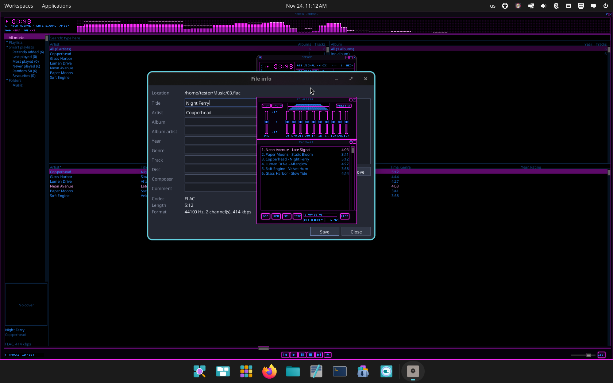
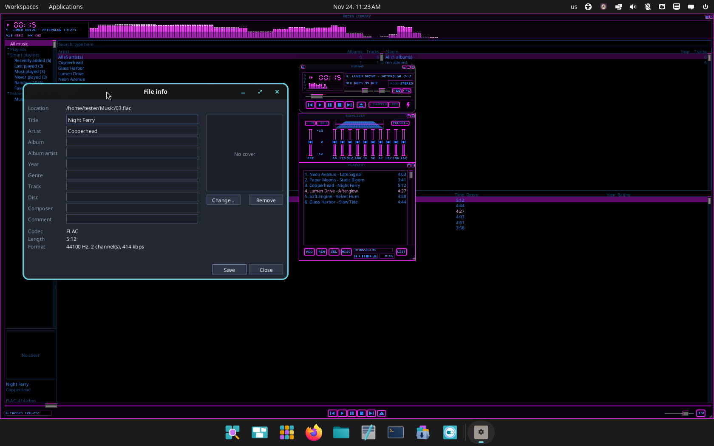

# Popamp on Wayland, and on COSMIC (Pop!_OS)

Popamp is a player of several small windows that dock, snap and move
together, as Winamp's did. Everything that makes that work on Windows
and X11 rests on one thing: a program knows where its windows are and
can put them where it wants. Wayland gives a program neither. This page
explains what Popamp does about that, what works, what does not, and
why: on Wayland desktops in general and on COSMIC, the desktop of
Pop!_OS 24.04, in particular.

## Which window system Popamp uses

| Desktop | Popamp runs as | Why |
|---|---|---|
| X11 session (Xfce, MATE, Cinnamon, i3…) | X11 program | Everything works. |
| GNOME, KDE Plasma and most Wayland desktops | X11 program through Xwayland | Xwayland lets a program place its windows, so everything works as on X11. |
| **COSMIC** (Pop!_OS 24.04) | **Wayland program** | COSMIC's Xwayland keeps a mapped X11 window where it is, whatever the program asks, so under Xwayland the windows could not be dragged at all. |
| A Wayland desktop with no Xwayland | Wayland program | There is nothing else. |
| Any Wayland desktop with `wayland=1` in `popamp.ini` | Wayland program | Asked for. |

So the limits below concern COSMIC, desktops without Xwayland, and
`wayland=1`. Where Popamp runs through Xwayland, none of them apply.

## How the windows are built on Wayland

On Wayland only the main window is a real window (an `xdg_toplevel`).
The equalizer, the playlist, the menus and the tooltips are **popups**
of it (`xdg_popup`). A program may place its own popups, each against
its parent window, which is the only placing Wayland allows a program.
So the other windows stay docked to the main window and move with it.

They are popups rather than subsurfaces because COSMIC cuts every
floating window to its rounded outline: subsurfaces outside the main
window were not shown at all, and menus only where they lay over it.
Subsurfaces are still used where a compositor has no popups to give, or
with `POPAMP_WAYLAND_SUBSURFACES=1`.

The media library, the dialogs and the visualizer are windows of their
own, placed by the compositor.

## Wayland in general

What any Wayland compositor withholds from a program, and what that
means for Popamp:

- **No window positions.** A program is never told where its window is
  on the screen, and cannot move it there. Popamp therefore:
  - does not remember where its windows were, and the compositor puts
    the main window where it likes at each start;
  - cannot snap the main window to the screen's edges or to other
    programs' windows itself (the compositor may, see COSMIC below);
  - cannot keep a menu opened at the screen's edge inside the screen,
    so it can go past it.
- **The compositor moves the main window.** A drag by its title bar is
  handed to the compositor, and Popamp does not see the window move.
  The equalizer and the playlist, as popups, go along with it.
- **No always on top.** There is no request for it in the standard
  protocols.
- **No file drops** from the file manager on the windows.
- **The toolbar takes no keys.** As a layer of the desktop
  (wlr-layer-shell) the bar gets no keyboard focus. Use the mouse, the
  media keys or the global hotkeys. GNOME has no layer shell, so there
  the bar is not offered to a Wayland program (under Xwayland, GNOME's
  default, it works as on X11).
- **Global hotkeys** go through the desktop's GlobalShortcuts portal
  (KDE Plasma 6, GNOME 48, Hyprland), which asks the user once and lets
  them pick other keys. Without the portal there are none.
- What is not affected: playback, the tray icon, MPRIS and media keys,
  notifications, skins and scaling work as they do under X11.

## COSMIC (Pop!_OS 24.04)

COSMIC gives a program more than plain Wayland does, and Popamp uses it.
It also has habits of its own that Popamp has to work around.

### What works

- **Dragging every window.** The main window is dragged by the
  compositor. The equalizer and the playlist follow the mouse while
  dragged, even at the screen's edge. COSMIC reports pointer positions
  against a popup that lag behind the popup once it has moved, and the
  windows ran away at the edge, so Popamp follows the mouse's relative
  motion while the button is held instead. A device that gives no
  relative motion (a graphics tablet, a virtual machine's mouse) is
  followed where COSMIC reports it.
- **Snapping of the equalizer and the playlist** to the main window, to
  each other, to the screen's edges and to the desktop's panels.
  COSMIC tells Popamp where its main window is
  (`cosmic-toplevel-info`), and Popamp measures how much room the panels
  leave on the monitor with an invisible layer surface, so the windows
  stop at a panel instead of going under it.
- **Snapping of the main window** comes from COSMIC itself: its *Edge
  gravity* (Settings → Desktop → Window management). Turn it on for the
  main window to snap to the screen's edges.
- **Changing the size** (`Ctrl+D`, Options → size). COSMIC calls every
  floating window "tiled", and winit 0.30 then ignored a new size for
  the main window. Popamp builds with a fork of winit
  ([popamp/winit](https://github.com/popamp/winit), branch
  `popamp-0.30`) that resizes windows the user cannot resize anyway, and
  that keeps a maximize request (a corner drop, see below) from
  stretching the window. The fix is offered upstream as
  [winit#4847](https://github.com/rust-windowing/winit/pull/4847).
- **Hidden undocked windows.** While the main window is dragged, the
  equalizer and the playlist that are not docked to it are hidden and
  come back where they were, instead of travelling with it (as popups
  they would otherwise go along).
- **Moving the group by any of its windows.** With *Move docked windows
  together* (Options), dragging the docked equalizer or playlist by its
  title bar asks COSMIC to move the main window, and the whole group
  goes with it. This also lets the group be put against a panel while
  being held by the playlist.
- **The toolbar** is a layer of the desktop, keeps maximized windows
  out of its strip and takes the width COSMIC's panels leave it.

### What does not, and why

- **The group snaps only with Edge gravity.** When the group is dragged
  by the equalizer or the playlist, COSMIC moves the main window and
  snaps only the main window's own outline. The equalizer and the
  playlist do not snap to an edge or to other windows during such a
  drag; Popamp cannot help, since the drag is the compositor's.
- **Dropping the main window in a top corner.** COSMIC treats a drop in
  a corner as a request to tile the window into that quarter of the
  screen. Popamp's window has a fixed size, so it does not grow; COSMIC
  then leaves it at the quarter's top left corner. In the top left
  corner that is next to the screen's edge, as wanted; in the **top
  right corner it is the middle of the screen**. Popamp cannot move it
  from there (COSMIC's window management protocol has no request to
  place a window), cannot tell this tiling from COSMIC's usual state
  (it reports every floating window as tiled on all four sides), and
  COSMIC has no known setting to turn corner tiling off. Drop the
  window near the right edge, but not in the corner, and Edge gravity
  puts it against the edge.
- **Dialogs open under the equalizer and the playlist.** The equalizer
  and the playlist are popups of the main window, and COSMIC draws a
  program's popups over all its other windows, the dialogs included. A
  dialog opened from the media library (File info, for example) can
  come up partly under them. Popamp cannot place a dialog, so drag it
  aside by its title bar, each time it opens: it then shows whole.

  

  
- **No position memory, no always on top, no file drops**, as on every
  Wayland desktop (above).
- **Xwayland is no way out on COSMIC.** Its Xwayland does not let a
  program move a window that is already shown, so as an X11 program
  Popamp's windows could not be dragged at all. Popamp therefore never
  picks X11 on COSMIC, even where Xwayland runs.

### Snapping at a glance on COSMIC

| Dragged | Snaps to edges and panels | Snaps to other windows | By whom |
|---|---|---|---|
| Main window (or the group by the main window) | with Edge gravity | no | COSMIC |
| Equalizer or playlist, undocked | yes | to Popamp's windows | Popamp |
| Group by the equalizer or the playlist | with Edge gravity, by the main window's outline | no | COSMIC |

## What would remove these limits

None of this can be fixed inside Popamp alone; each needs something
from the compositor or from Wayland:

- A way for a program to place its windows and learn where they are.
  Wayland has none for ordinary programs; a protocol for it would let
  Popamp work as on X11.
- On COSMIC: an Xwayland that lets X11 programs move their windows
  (reported as
  [cosmic-comp#3096](https://github.com/pop-os/cosmic-comp/issues/3096)),
  or a request in `cosmic-toplevel-management` to place a window. Either
  would also restore always on top and position memory.
- On COSMIC: not tiling a window whose smallest and largest sizes are
  the same, which would end the corner drop problem.
- Upstream winit: releasing
  [winit#4847](https://github.com/rust-windowing/winit/pull/4847), so
  Popamp can drop its fork.

Until then, where Xwayland lets programs place windows (GNOME, KDE
Plasma and most others), Popamp runs through it and none of the above
applies.
